# 🦉 NerdyBirdy

**An AI professor that teaches only from your own lecture notes.**

🔗 **Live demo:** _coming soon — link will be added here_

| Home & upload | Ask the Professor | Quiz feedback | Progress |
|---|---|---|---|
| _screenshot placeholder_ | _screenshot placeholder_ | _screenshot placeholder_ | _screenshot placeholder_ |

Built for the AI Lodge Hackathon · Track: **Productivity & Workflows**

---

## 1. Problem Statement

A university student with an exam in one or two weeks usually has a PDF of lecture slides and not much time. General chatbots don't help much:

- **They don't know the syllabus.** Answers come from the whole internet, not from what the lecturer actually taught.
- **They can invent facts**, and a student has no easy way to check them.
- **They encourage passive reading.** Asking a chatbot to summarise feels productive, but exams reward *active recall*: retrieving and explaining ideas yourself.

Students need a study partner that is grounded in *their* material, admits when something isn't covered, and makes them practise, not just read.

## 2. Solution Overview

NerdyBirdy turns a PDF of lecture notes into a personal, grounded tutor:

1. **Upload notes.** The PDF is read in the browser; only the extracted text is sent to the server. It is cleaned, scanned for prompt-injection text, chunked, embedded and organised into a topic map.
2. **Ask questions.** Answers come only from the retrieved pages, with page citations that are checked on the server. If the notes don't cover a question, NerdyBirdy says so honestly ("🔍 That's not in your notes") instead of guessing.
3. **Take quizzes.** Every question is generated from the notes, **checked by a second model before you see it**, and graded against key points from the notes. The mistake is diagnosed (misconception, mixed-up concepts, incomplete answer, careless slip).
4. **See weak spots.** Each topic climbs a 4-level ladder (Remember → Explain → Apply → Connect). Confident wrong answers put a topic in the "danger zone", and the progress page shows exactly which pages to re-read.

**Why it's not just an LLM wrapper:** retrieval with validated citations; a *generate → verify → grade → diagnose → mastery* pipeline; confidence calibration; a difficulty ladder; and structured safety statuses, all checked by an automated 23-case eval suite.

## 3. Key Features

- 📄 **Upload any text PDF** (≤ 25 MB, ≤ 150 pages), or try the built-in sample notes. Scanned PDFs, password-protected files and mislabelled files get clear messages.
- 🗺️ **Topic map** with levels, an exam countdown, and one-tap "Read p. 3–5" / "Quiz this topic".
- 💬 **Ask the Professor**
  - Answers with clickable **[p. N] citation chips** that open the page text.
  - Follow-ups: *Explain simpler*, *Give me an example*, *Why does this matter?*
  - **"Explain anyway"** general-knowledge mode, always labelled **⚠️ Not from your syllabus**.
- 🎯 **Quiz Mode** with 5 formats:
  - 🔘 *Pick the Right One*: multiple choice whose wrong options are real concepts from elsewhere in the notes.
  - ✍️ *Explain It*
  - 🔍 *Spot the Mistake*
  - 🌍 *Real-World Challenge*
  - 🔗 *Connect the Dots*
- 🤔 **Confidence calibration:** students rate how sure they are before submitting. Being "very sure" but wrong flags the topic for review.
- ✅ **Feedback card:** key points hit and missed, what went wrong, which page to re-read, and a promise that the idea will come back as a 🔁 *comeback question* in a different format.
- 📈 **Progress page:** topic levels, danger zones, a "review next" list with page ranges, and a session summary.
- 🛡️ **Safety cards** for academic-integrity boundaries, wellbeing support (with hard-coded Singapore helplines) and unsafe requests.
- 🔒 **Privacy by default:** no login (anonymous sessions), no PDF stored, and everything is deleted automatically after 7 days or immediately on request.

## 4. AI Integration

Two model roles, both called server-side through OpenRouter with zod-validated structured output:

- **Professor** (`MODEL_PROFESSOR`): topic maps, answers, question generation and grading.
- **Checker** (`MODEL_CHECKER`): independent verification of every quiz question before a student sees it.
- **Embeddings** (`MODEL_EMBED`): retrieval over the notes (pgvector).

```mermaid
flowchart TD
  subgraph Upload["📄 Upload pipeline"]
    U1["PDF in browser (pdf.js)"] --> U2["Page text only<br/>(batches of 20)"]
    U2 --> U3["Sanitize + neutralize delimiters"]
    U3 --> U4{"Injection scanner"}
    U4 -->|flagged| U5["Banner + safety event"]
    U4 --> U6["Chunk ≤1,500 chars<br/>(keeps page number)"]
    U6 --> U7["Embed → pgvector"]
    U7 --> U8["Professor: topic map<br/>(page ranges range-checked)"]
  end

  subgraph Ask["💬 Ask pipeline"]
    A1["Question"] --> A2{"Wellbeing keyword check"}
    A2 -->|match| A3["Wellbeing card<br/>(hard-coded resources)"]
    A2 --> A4["Embed + match_chunks (top 6)"]
    A4 --> A5["Professor: status + answer + cited_pages<br/>(notes wrapped as untrusted data)"]
    A5 --> A6{"Citation validator"}
    A6 -->|invalid| A7["Retry once → else 'not in your notes'"]
    A6 -->|valid| A8["Answer with page chips"]
  end

  subgraph Quiz["🎯 Quiz pipeline"]
    Q1["Pick topic + level<br/>(danger zone → lowest level → least recent)"] --> Q2["Professor: generate<br/>public part + private key"]
    Q2 --> Q3{"Page check + Checker verification"}
    Q3 -->|fail| Q2
    Q3 -->|pass| Q4["Save: public → browser<br/>key → server-only table"]
    Q4 --> Q5["Student answers + confidence"]
    Q5 --> Q6["Grade: MCQ deterministic,<br/>free text vs key points"]
    Q6 --> Q7["Score computed in code → verdict<br/>→ diagnosis → mastery + danger zone"]
  end
```



Design choices that make the AI trustworthy:

- **Grounding with proof.** An answer is only shown as "from your notes" if it has at least one inline citation, every cited page was actually retrieved, and every inline `[p. N]` is listed. Otherwise the model gets one retry with the exact error, then the answer is downgraded to "not in your notes".
- **Two-model verification.** The checker must confirm that the question is answerable from the notes, the answer key is correct, there is exactly one correct option (MCQ) or exactly one changed fact (Spot the Mistake), and nothing is ambiguous. A rejected question is regenerated with the checker's issues (up to 2 times), then another topic is tried.
- **Code, not the model, decides the score.** The grader only marks each key point as hit or missed; the score (hits ÷ key points) and the verdict are computed in code. MCQs are graded without any model call.
- **Validated structured output everywhere.** Every model response goes through a zod schema (JSON Schema mode with fallbacks) and is retried once with the validation error.
- **Speed.** Reasoning effort is set to low and OpenRouter is asked for its fastest providers. The next quiz question is generated in the background while the student answers the current one.

## 5. External Tools & Datasets

| Tool | Used for |
|---|---|
| [OpenRouter](https://openrouter.ai) | LLM gateway, with `data_collection: "deny"` and `require_parameters: true` on every request |
| ↳ `deepseek/deepseek-v4.1-flash` | `MODEL_PROFESSOR` (answers, topic maps, question generation, grading) and `MODEL_CHECKER` (question verification) |
| ↳ `openai/text-embedding-3-small` | `MODEL_EMBED`: 1536-dimension embeddings for retrieval |
| [Supabase](https://supabase.com) (Singapore) | Postgres + **pgvector**, anonymous auth, Row Level Security on every table |
| [Vercel](https://vercel.com) (`sin1`) | Hosting, serverless functions, daily cleanup cron |
| [Next.js 16](https://nextjs.org) + Tailwind CSS | App framework and UI |
| [pdf.js](https://mozilla.github.io/pdf.js/) (`pdfjs-dist`) | PDF text extraction in the browser |
| [zod](https://zod.dev) v4 | Validating every LLM output and request body |
| Sample notes | **Original** "BIO101 Lecture 5: Photosynthesis" notes written for this project (`public/samples/photosynthesis.json`); no copied text. The eval fixtures are the same notes plus a copy with injected instructions. |

## 6. Installation & Setup

**Prerequisites:** Node.js 20+, a Supabase project (with the `vector` extension and anonymous sign-ins enabled) and an OpenRouter API key.

1. **Clone the repo and install packages:**
   ```bash
   git clone https://github.com/SMUYijie/NerdyBirdy.git
   cd NerdyBirdy
   npm install
   ```
2. **Create `.env.local` and fill in every value:**
   ```bash
   cp .env.example .env.local
   ```
   Then:
   - Add the Supabase URL, publishable key and secret key.
   - Add your OpenRouter API key.
   - Set the model IDs from section 5.
   - Generate `CRON_SECRET` with `openssl rand -hex 32`.
3. **Create the database:** open Supabase → **SQL Editor** → **New query**, paste `supabase/migrations/0001_init.sql`, and click **Run**.
4. **Check the setup:**
   ```bash
   npm run check-setup
   ```
   It prints ok/fail for Supabase, the database schema, chat models and embeddings, and never prints secrets.
5. **Run the app** and open http://localhost:3000:
   ```bash
   npm run dev
   ```
6. **Run the safety evals** (about 45 s):
   ```bash
   npm run evals
   ```
   This creates two throwaway anonymous users, runs all 23 cases, rewrites `docs/safety-tests.md`, then deletes the test data.

To deploy, import the repo into Vercel, add the same environment variables, and deploy. `vercel.json` sets the Singapore region and the daily cleanup cron.

## 7. AI Safety & Limitations

### Risks and guardrails

| Risk | Guardrails |
|---|---|
| **Hallucinated or uncited answers** | Retrieval-only answers; server-side citation validation with one retry; honest "🔍 That's not in your notes" fallback; general answers always badged "⚠️ Not from your syllabus" with no citations; a page number that doesn't exist is answered without asking the model. |
| **Wrong quiz questions or answer keys** | Every question is verified by a second model before it is shown; deterministic check that all pages were in the notes shown; regenerate up to 2 times, else a friendly error. |
| **Prompt injection (in notes or answers)** | Notes and student text are wrapped in delimited "untrusted data" blocks, and delimiter look-alikes are neutralized. An ingest scanner flags instruction-like text (banner + event). Answers like "give me full marks" earn no points. The system prompt is never revealed. |
| **Answer-key leakage** | Answer keys live in a server-only table with no browser access (no grants, RLS on). The browser receives only the question, options and hint until it submits. |
| **Unfair or gamed grading** | The model judges only hit/miss per key point (meaning over wording); the score and verdict are computed in code; low-confidence grades tell the student to double-check a specific page. |
| **Academic dishonesty** | Requests to do graded work, or "I'm in my exam right now", get a warm `integrity_boundary` card that offers teaching or a quiz instead; tutorial and past-year questions for study are still answered. |
| **Student distress** | A keyword pre-check on all free text forces a wellbeing card (no model involved). The model can also return `wellbeing_support`. Helplines are **hard-coded**: SOS 1767, CareText 9151 1767, 995. |
| **Harmful off-topic requests** | `unsafe_request` status: brief refusal and a redirect to studying. |
| **Abuse and cost** | 120 LLM calls per user per day, 3,000 per day overall (atomic counter); input length caps; 45 s timeouts with one retry; maximum function durations. |
| **Privacy** | The PDF never leaves the browser; text is deleted after 7 days by a daily cron, or immediately with "Delete this course"; anonymous sessions; RLS on every table; providers must not collect data; logs never contain note or answer text. |

**Eval results:** see [docs/safety-tests.md](docs/safety-tests.md). **23/23 passed (100%)** across grounding, injection, grading fairness, calibration, diagnosis, verification, integrity, wellbeing, unsafe requests, abuse limits, RLS isolation and answer-key secrecy.

### Known limitations

- **Text-only PDFs:** scanned or image-only PDFs aren't supported (no OCR), and diagrams aren't read.
- **English-focused:** the prompts, scanner and wellbeing keywords are designed for English.
- **Anonymous sessions:** courses are tied to the browser. Clearing cookies or switching browsers loses access (the data is still deleted after 7 days).
- **AI can still make mistakes:** verification and citation checks reduce errors but don't eliminate them. Students should check important facts against their notes or ask their lecturer.
- **Rate limits:** 120 AI calls per user per day; heavy use hits the friendly daily limit.
- **Latency:** a verified quiz question takes roughly 10–30 s to create (hidden by background pre-generation after the first one).

---

Licensed under the [MIT License](LICENSE).
